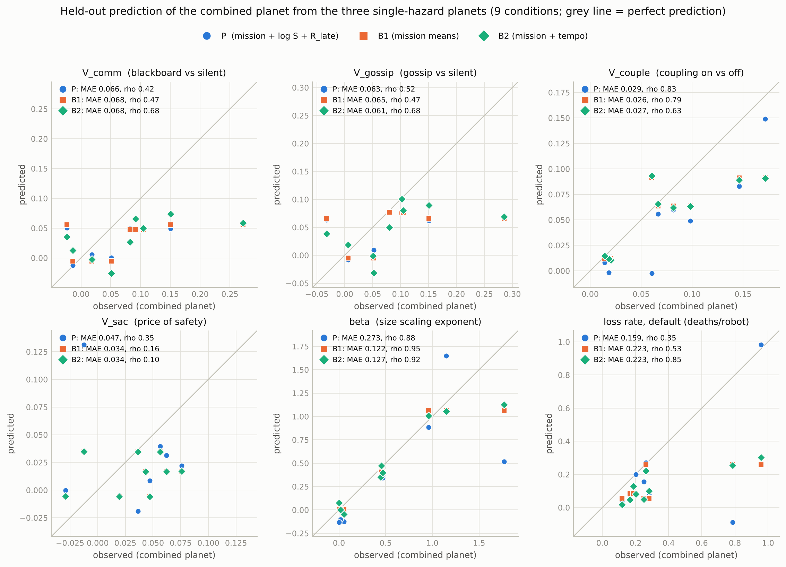
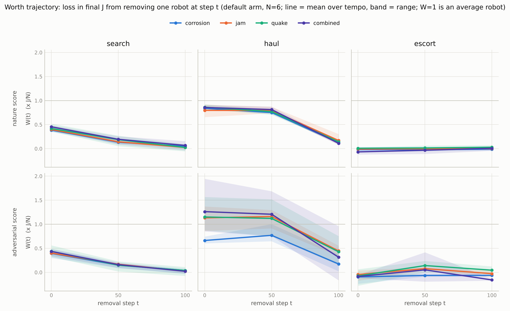
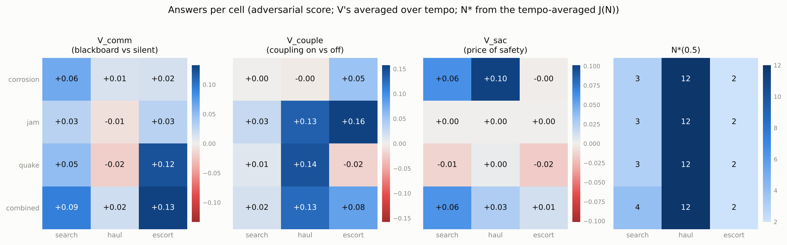
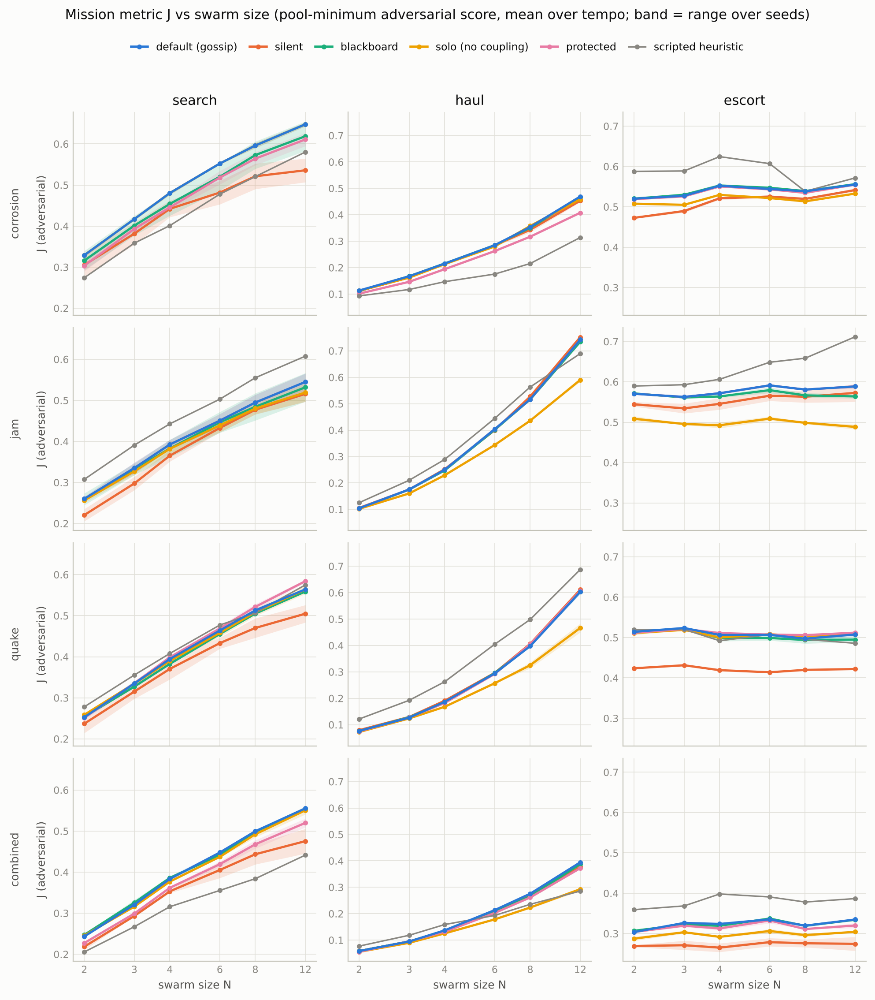

# Hostile Planets — results

**The claim under test:** a small number of shared principles (how fast
information goes stale, how a robot's worth to the mission changes over time)
govern how a swarm should coordinate, couple, be sized and spend its members,
so that results from one hostile world predict another.

**Verdict: not supported, 0 of 6 outcomes**, by the rule fixed in
[`docs/PREREGISTRATION.md`](../docs/PREREGISTRATION.md) before any result
existed. The two principle variables predict a held-out planet no better than
knowing the mission alone. Two validity caveats apply to everything below:
one of the three pre-registered validity checks failed (the learned swarms do
not match a scripted heuristic in enough cells), and the "learned adversary"
is a learned correction to a scripted pursuit rule, not a from-scratch policy.

What did hold up is narrower and mostly a statement about missions, not
planets: swarm-size scaling and the worth trajectory are set almost entirely
by the mission and carry over across planets; the value of communication and
of tight coupling does not follow the two principles, but an unplanned,
parameter-free predictor (average the three single-hazard planets at the same
mission and hazard speed) ranks the combined planet well.

## 1. What was run

* 4 planets x 3 missions x 5 arms x 2 seeds = 120 co-training runs of a swarm
  policy against a hazard adversary (150 PPO iterations, 128 environments,
  about 2.9 million environment steps each), no failures.
* 24 best-response adversaries (the co-trained adversary fine-tuned for 60
  iterations against each frozen `default` swarm).
* Evaluation: every policy at 3 hazard tempos x 6 swarm sizes, under
  random-walk ("nature") hazards and under each of the 10 learned adversaries
  of its cell, 128 episodes per row; the adversarial score is the minimum over
  those 10. 30,024 rows in [`eval.csv`](eval.csv).
* One condition = (planet, mission, tempo): 36 in total, 27 on the
  single-hazard planets and 9 on `combined`.

Arms differ from `default` (local gossip, coupling mechanics on, no death
penalty) in one factor: `silent`, `blackboard`, `solo` (coupling mechanics
off), `protected` (death penalty in training). Outcomes are relative
differences in the mission metric `J`: `V_comm` (blackboard vs silent),
`V_gossip` (gossip vs silent), `V_couple` (default vs solo), `V_sac` (default
vs protected, the price of safety), plus the size-scaling exponent `beta` and
the default arm's loss rate.

## 2. Validity checks

| check (pre-registered) | result |
|---|---|
| Learned `default` matches or beats the scripted heuristic in at least 9 of 12 cells (nature, N=6, tempo 0.3) | **Fails: 6 of 12.** All four `search` cells fall short by 0.07-0.12 in `J`; `corrosion/escort` and `combined/escort` by 0.02-0.03 |
| The learned adversary lowers `J` for `default` in most cells | Passes: 11 of 12. In `corrosion/search` the swarm scores 3% *higher* against the adversary than against nature |
| Best-response adversary as an exploitability check on the pool minimum | Mean gap 0.001 in `J`; largest per-cell mean 0.019 (`corrosion/escort`). The best response beats the pool minimum in 45% of rows, by little |
| Seed-to-seed spread vs between-condition spread | No outcome flagged under the adversarial score. Under nature, `V_comm` is unresolved (seed spread 0.046 > condition spread 0.039) |

How to read these:

* **The swarms are under-trained, most clearly in search.** An exploratory
  check that continued seven `default` runs to three times the budget closed
  part of the gap everywhere and reversed it in `quake/haul` (section 6). The
  pre-registered sensitivity analysis that drops the six failing cells also
  gives 0 of 6.
* **The best-response check is weak evidence.** The best responses come from
  the same family (a residual on the pursuit rule, 60 iterations), so a small
  gap shows the pool minimum is stable within that family, not that it is a
  worst case.
* **The search adversary is not a worst case.** It lowers `J` by 6-13% on three
  planets and not at all on corrosion. I did not diagnose why.

## 3. Primary test: does one world predict another?

Model P predicts each outcome from mission intercepts plus two shared slopes,
on log staleness ratio `S` and late worth `R_late`. Baseline B1 is mission
means; B2 adds a slope on the raw tempo dial. "Supported" needs P to beat both
baselines by 10% in held-out error **and** reach a rank correlation of 0.5 on
leave-one-planet-out predictions.

Leave-one-planet-out, adversarial score, 36 predictions:

| outcome | error P | error B1 | error B2 | P vs B1 | rank corr. P | supported |
|---|---|---|---|---|---|---|
| `V_comm` | 0.053 | 0.053 | 0.057 | 0% | 0.32 | no |
| `V_gossip` | 0.054 | 0.055 | 0.056 | -2% | 0.37 | no |
| `V_couple` | 0.048 | 0.052 | 0.052 | -8% | 0.32 | no |
| `V_sac` | 0.039 | 0.037 | 0.037 | +5% | -0.19 | no |
| `beta` | 0.187 | 0.122 | 0.134 | +53% | 0.84 | no |
| loss rate | 0.177 | 0.238 | 0.236 | -26% | 0.29 | no |

(Error is mean absolute error; negative "P vs B1" means P is better.)

* Loss rate is the only outcome where the principle variables help, and there
  the ranking is poor.
* For `beta` the ranking is good, but mission means already rank it as well
  (0.81) and P is worse in error.
* The headline split (fit on the three single-hazard planets, predict
  `combined`) agrees: P beats both baselines by 10% only for loss rate (-29%),
  with rank correlation 0.35.
* Under the nature score (exploratory) it is also 0 of 6.

### Why the principle variables add nothing

* **The worth trajectory is a property of the mission.** Under nature hazards
  the four planets' curves lie on top of each other (figure below). Worth
  falls steadily in search, stays near one average robot until late in haul,
  and is about zero throughout escort. A variable that does not vary across
  planets cannot carry information from one planet to another beyond what the
  mission label already carries.
* **Measured staleness is partly chosen by the adversary.** In search on jam,
  quake and combined the blobs take 53-71 steps to move one blob-width at
  every tempo (35-60 on corrosion), which fits an adversary that parks them
  near targets; tempo only caps their speed. So `S` varies less than the dial
  suggests, and is confounded with the mission.
* **The arm effects are small.** Typical values of the `V` outcomes are
  0.02-0.15 against a seed-to-seed spread of 0.02-0.05, so there is little
  resolved variation left for any two-slope model to explain.

## 4. The four questions, mission by mission

All numbers are the adversarial score, averaged over tempo, swarm sizes 4-8
and two seeds unless stated. Verdicts on the pre-registered directional
expectations are in section 5.

### How should the swarm coordinate?

* **Local gossip is enough.** Gossip is the best communication mode in 9 of
  12 cells, but its margin over the global blackboard is at most 0.03 in `J`
  and usually under 0.01.
* **Communication matters for escort on quake and combined** (gossip vs
  silent +0.14 and +0.13, both seeds), **somewhat for search** (+0.05 to
  +0.11, but seed-dependent: on jam/search the two seeds give -0.01 and
  +0.11), and **not at all for haul** (-0.02 to +0.04).
* **In escort, communication turns harmful when hazards move fast.** On
  corrosion, quake and combined the value of gossip is positive at tempos 0.1
  and 0.3 and negative at 0.6 (corrosion: +0.04, +0.11, -0.12; quake: +0.20,
  +0.27, -0.04; combined: +0.15, +0.29, -0.03), in both seeds for corrosion
  and combined. This is the one place where the stale-information idea shows
  up clearly. Jam escort goes the other way (+0.03, +0.04, +0.07).

### When should it rely on tight coupling?

* **When the hazard has a co-presence countermeasure and the adversary is
  pressing.** Coupling is worth +0.13 to +0.16 on jam (haul and escort, the
  beacon mechanic), +0.14 on quake/haul and +0.13 on combined/haul (joint
  carry plus rescue), +0.08 on combined/escort, consistently across seeds.
* **About zero** in search on every planet (0.00-0.03), on corrosion/haul and
  on quake/escort.
* **Much smaller without an adversary**: at most +0.06 under nature hazards.

### How large should it be?

* **Set by the mission.** Scaling exponent `beta` (slope of log `J` on log N):
  escort about 0 (two escorts do as well as twelve), search about 0.4
  (diminishing returns), haul 0.8-1.3.
* **Haul under adversarial pressure scales faster than linearly** at high
  tempo (up to 1.77), because small swarms deliver almost nothing.
* With a per-robot cost of half a two-robot swarm's per-robot output, the
  best size is 2 for escort, 3-4 for search and 12 (the largest tested) for
  haul.

### When should it sacrifice a member?

* **Accepting losses pays only where the hazard kills, and only for search
  and haul.** The price of safety is +0.06 on corrosion/search, +0.10 on
  corrosion/haul and +0.06 on combined/search. The protected swarms lose fewer
  robots (corrosion/search 16% vs 25% of the swarm; corrosion/haul 67% vs
  77%) and score that much lower.
* **In escort, protection is free.** On corrosion and quake escort the
  protected swarm loses far fewer robots (5% vs 9%, 1.5% vs 8%) with no
  measurable cost in `J`; escort deaths buy nothing for the VIP.
* **No evidence of "spend a robot once its worth has fallen".** Exposure to
  hazards on corrosion and combined is higher in the first third of the
  mission than the last, and across conditions exposure rises with a robot's
  worth rather than falling (rank correlation +0.38). Robots are exposed where
  the work is, not where they are cheap.

## 5. Pre-registered directional expectations

| # | expectation | adversarial | nature |
|---|---|---|---|
| 1a | `V_comm` >= 0 in most conditions | pass (72%) | pass |
| 1b | `V_comm` declines at the highest tempo | mixed (half the cells; all the large declines are in escort) | pass |
| 1c | `V_comm` decreases as `S` grows | mixed | mixed |
| 1d | `V_comm` smaller on jam at matched `S` | pass | pass |
| 2a | `V_couple` ordered escort > haul > search | **fail** (haul 0.10, escort 0.07, search 0.01) | fail |
| 2b | `V_couple` largest on quake | **fail** (jam 0.11, combined 0.08, quake 0.04) | fail |
| 2c | `V_couple` decreases with `S` | mixed | fail |
| 3a | `beta` < 1 everywhere | mixed (83% of conditions; haul exceeds 1) | pass |
| 3b | `beta` smallest for escort | pass | pass |
| 3c | killing hazards raise the best size relative to jam | pass / mixed / fail at the three cost levels | pass |
| 4a | `V_sac` > 0 on corrosion and combined | pass (83% of conditions) | pass |
| 4b | `V_sac` about 0 on jam | pass, but by construction (see section 7) | pass |
| 4c | exposure higher late than early on corrosion/combined | **fail** | fail |
| 4d | exposure falls as worth rises | **fail** (it rises) | fail |

## 6. Exploratory analyses (not pre-registered)

**A parameter-free predictor does better than the principle model.** Predict
the combined planet's outcome at each (mission, tempo) by the mean of the
three single-hazard planets at the same (mission, tempo):

| outcome | error, matched mean | error, P | error, B1 | rank corr., matched mean | rank corr., P |
|---|---|---|---|---|---|
| `V_comm` | 0.050 | 0.066 | 0.068 | 0.93 | 0.42 |
| `V_gossip` | 0.043 | 0.063 | 0.065 | 0.93 | 0.52 |
| `V_couple` | 0.026 | 0.029 | 0.026 | 0.83 | 0.83 |
| `V_sac` | 0.032 | 0.047 | 0.034 | 0.22 | 0.35 |
| `beta` | 0.098 | 0.273 | 0.122 | 0.92 | 0.88 |
| loss rate | 0.223 | 0.159 | 0.223 | 0.80 | 0.35 |

So one world does say something about another, through the mission and the
hazard speed directly, not through `S` and `R_late`. This is nine conditions,
chosen after seeing the data; treat it as a hypothesis for a follow-up, not a
result.

**Budget check.** Seven `default` swarms (seed 0) were trained for 300 more
iterations (450 in total) and compared with the scripted heuristic under
nature, averaged over all tempos and sizes:

| cell | gap at 150 iterations | gap at 450 iterations |
|---|---|---|
| corrosion/search | -0.058 | -0.025 |
| jam/search | -0.111 | -0.080 |
| quake/search | -0.094 | -0.056 |
| combined/search | -0.046 | -0.010 |
| quake/haul | -0.024 | **+0.121** |
| quake/escort | -0.007 | -0.005 |
| combined/escort | -0.029 | -0.022 |

The policies in the grid had not converged. The size of the `quake/haul` jump
means arm differences in that cell could change with more training.

**Learned vs heuristic under the adversary.** Averaged over all conditions,
the learned swarm beats the scripted heuristic in 5 of 12 cells under the
adversarial score (corrosion search and haul, combined search and haul, quake
escort) and in 4 of 12 under nature.

## 7. Deviations and things to know before trusting a number

* **Six amendments to the pre-registration** were made before the grid ran and
  are listed in that document (tempo grid, rebalanced constants, the adversary
  as a residual on a pursuit rule, the staleness window, the escort metric).
* **Evaluator fix after the first evaluation.** The first evaluation ran the
  `default` arm on different episodes from the other arms, and its N=6 rows on
  512 episodes instead of 128. Because the adversarial score is a minimum over
  ten noisy means, that biased the three default-vs-other comparisons slightly
  in `default`'s favour at N=6. I found it because the price of safety on jam
  was non-zero although the two policies are identical. The `default` arm's
  standard rows were re-evaluated on the shared episodes
  ([`scripts/patch_eval_default.py`](../scripts/patch_eval_default.py)); no
  other row changed, and the verdict was 0 of 6 before and after.
* **More episodes for the worth rows.** A 32-episode preview showed `W(t)` was
  dominated by noise, so those rows use 512 episodes. This was decided after
  seeing seed-0 preview data, before the full evaluation.
* **Structural zeros.** On the jam planet nothing kills robots, so `protected`
  and `default` are bit-identical policies (all three jam cells, both seeds)
  and `V_sac` is exactly 0 there; on corrosion/search no coupling mechanic
  applies, so `solo` equals `default` and `V_couple` is exactly 0. These 12 of
  the 72 `V_sac`/`V_couple` condition values are not findings.
* **Uncertainty.** The intervals in the tables propagate evaluation noise
  only. With two seeds, seed-to-seed spread (0.02-0.05 on the `V` outcomes) is
  the larger uncertainty and is poorly estimated.

## 8. Limitations

* Abstract 2-D kinematic simulator with engineered observations and a scripted
  VIP; nothing here is a claim about real robots.
* Policies are under-trained (section 6) and below a simple scripted
  heuristic in half the cells.
* The adversary is a learned correction to pursuit; it is not shown to be a
  worst case, and in search it is not even reliably adverse.
* Every hazard's coupling countermeasure was designed by hand, so "when to
  couple" partly reflects those design choices (for example, jam has a strong
  beacon mechanic and corrosion only has shielding of the VIP).
* One factor at a time: no interaction between communication, coupling and
  protection is estimated.
* Two seeds, three tempos, one arena size, one episode length.

## 9. Files

* [`eval.csv`](eval.csv), schema in [`docs/EVAL_SCHEMA.md`](../docs/EVAL_SCHEMA.md)
* [`summary.json`](summary.json): every verdict above in machine-readable
  form, with the way each ambiguity in the pre-registration was resolved
* [`tables/`](tables): per-condition outcomes, principle variables, transfer
  predictions and coefficients, validity tables, `exploratory_*.csv`
* [`figures/`](figures): the four above plus the data collapse against `S`,
  exposure by mission third, and training curves
* [`eval_extended.csv`](eval_extended.csv): the budget check
* `raw/`: all trained policies and training curves
